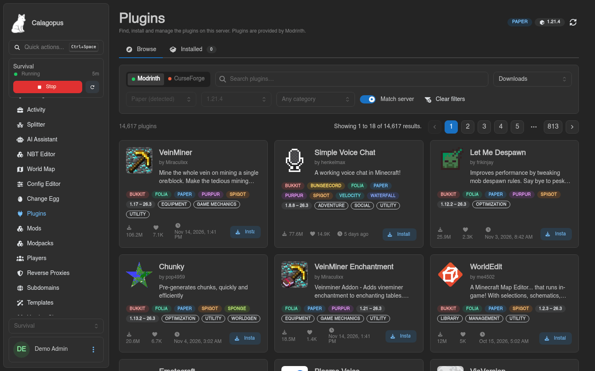
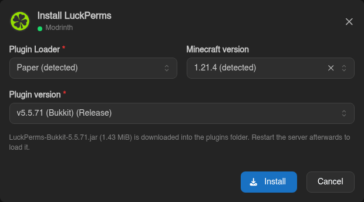
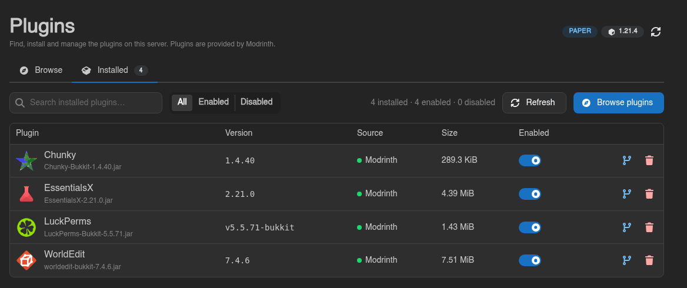
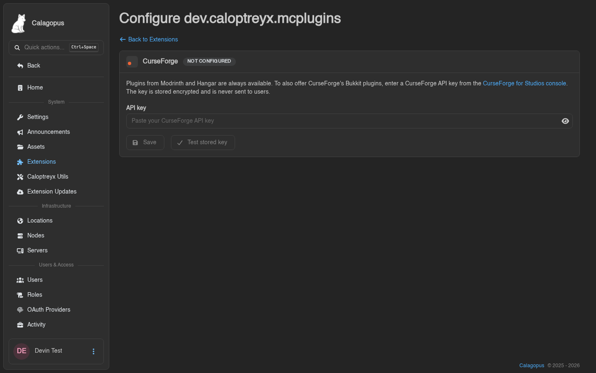

# MC Plugins Installer

An easy-to-use Minecraft plugin installer and manager for the [Calagopus Panel](https://github.com/calagopus/panel).
Plugins come from [Modrinth](https://modrinth.com), [Hangar](https://hangar.papermc.io) (PaperMC's plugin repository)
and, once an administrator adds an API key, [CurseForge](https://www.curseforge.com/minecraft/bukkit-plugins). The
extension works on its own: it needs no other extension.

## Features

- **Browse**: search plugins in a card grid with a Modrinth / CurseForge / Hangar switch, filters for Plugin Loader,
  Minecraft version and category, and a sort order. The **Match server** switch (on by default) narrows results to the
  detected platform and Minecraft version. Filters live in the URL, so a filtered view can be bookmarked or shared.
- **Installed**: every jar in the server's `plugins/` folder (`.jar` in any case, and disabled `.jar.disabled`) in a
  searchable table, identified by file hash. Enable or disable plugins, switch their version, update them, or delete
  them. Jars built for another platform are flagged **Wrong platform**, and a plugin with two enabled jars is flagged
  **Installed twice** (the server refuses to load both).
- **Updates**: identified plugins show **Update to x.y** when a newer release runs on the server (beta updates behind
  the **Include beta updates** switch). The **Updates** filter lists them, and **Update all** shows a review list
  first and then updates one plugin at a time.
- **Plugin details**: description, stats, links, and a Versions table with pagination and filters (search, loader,
  Minecraft version, release channel, and a **Compatible only** switch). Release versions are shown by default.
- **Install / switch modal**: picks the plugin version for the detected platform and Minecraft version (beta and
  alpha versions behind a switch) and offers to install the plugin's **required dependencies** as well. Builds for
  another platform can't be installed: the button says why.
- **Server software panel**: the detected software, Minecraft version and build or loader version, where each came
  from and how sure the detection is, the evidence it found and any conflicts. **Set manually…** stores an override;
  **Clear override** removes it.
- All texts are translatable.

### Sources

| Source | Plugins | Identification of installed jars | Download check |
|---|---|---|---|
| Modrinth | all plugin loaders | SHA-1 | SHA-512 |
| CurseForge | the "Bukkit Plugins" section (Bukkit, Spigot, Paper, Purpur and hybrids) | CurseForge fingerprint | CurseForge fingerprint |
| Hangar | Paper (and Folia when the project supports it), Velocity, Waterfall | install record (see below) | SHA-256 |

- Modrinth is queried straight from the browser. CurseForge and Hangar go through this extension's backend, which
  caches results (search, projects and versions for 5 minutes, CurseForge categories for 6 hours, CurseForge
  fingerprint matches for 24 hours) and limits requests per user.
- Hangar has no lookup by hash. When a plugin is installed from Hangar, the extension records its file name, SHA-256,
  project and version in `/.mc-plugins-installer.json`, and uses that record to recognise and update the jar later.
  Hangar jars installed by other means show as unknown.
- Hangar versions hosted outside Hangar are marked **External download** and are not installed from the panel.
- CurseForge authors can disallow third-party downloads. Such versions are marked **Manual download**. If Modrinth
  publishes the identical file (same SHA-1), the modal offers **Install the identical file from Modrinth**. Otherwise it
  links to the file on CurseForge and offers **Upload the .jar**: the upload is checked against the file's CurseForge
  fingerprint before it is moved into `plugins/`, and anything else is removed again.

### Supported platforms

Paper, Purpur, Folia, Spigot, Bukkit, Sponge, the hybrids Mohist, Arclight and Youer, and the Velocity, BungeeCord and
Waterfall proxies. What each shows:

- Purpur: Purpur, Paper, Spigot and Bukkit plugins; Paper: Paper, Spigot and Bukkit plugins.
- Folia: only Folia-compatible builds.
- Hybrids: Spigot and Bukkit plugins.
- Velocity: Velocity plugins; Waterfall: Waterfall and BungeeCord plugins; BungeeCord: BungeeCord plugins. Proxies have
  no Minecraft-version filter.

Servers that run a mod loader (Fabric, Quilt, Forge, NeoForge), vanilla, or no Minecraft at all get a short "This
server doesn't run a plugin platform" page with what was detected and the override button instead of the plugin
pages. The panel can't hide a sidebar entry per server, so to hide **Plugins** on such servers, hide the page for those
eggs in the egg configuration.

### How detection works

Detection runs in the browser and reads the server's files through the panel's own file routes. Each value (software,
Minecraft version, build or loader version) is taken from the highest-ranked source that has it:

1. **Manual override** in `/.mc-plugins-installer.json` (see below).
2. **Launch arguments**: `unix_args.txt`, `run.sh` and the `@libraries/.../unix_args.txt` file it points to, and the
   Forge shim jar name.
3. **`logs/latest.log` and `version_history.json`**, but only if they are newer than the newest install artifact
   (server jars, loader libraries, `unix_args.txt`, install markers). An older log or history is from before the last
   software change: it drops to rank 6 with low confidence and the panel says the log is older than the install.
4. **Install markers** other tools may leave on the server: `.mcvc-type.json` and `.modpack-installer.json` (optional;
   used only when present).
5. **Files**: config files the platform writes (`purpur.yml`, `config/paper-global.yml`, `paper.yml`, `spigot.yml`,
   `bukkit.yml`, `velocity.toml`, `waterfall.yml`, `modules.yml`, `config/sponge/`) count only when they are not older
   than the server jar, so a leftover `purpur.yml` no longer makes a Paper server "Purpur"; Folia and the hybrids are
   recognised from jar names and their own folders; mod loaders from their library folders (the newest wins); the
   Minecraft version from the newest `versions/` folder.
6. A stale log (low confidence).
7. **Startup variables** (non-secret, user-viewable ones; needs `startup.read`).
8. **Egg name**, then nest name, startup command and Docker image.

The Paper / Purpur / Folia build comes from `version_history.json` (`1.21.4-232-main@…` or the older
`git-Paper-196 (MC: 1.20.1)`), proxy versions from the log. Snapshots and pre-releases (`26.3-pre-2`, `24w14a`) are
recognised. Sources of ranks 2 to 5 that disagree are listed as conflicts.

If nothing matches, typically on a server that has never been started, an alert asks you to start the server once
or set the software manually. You can still pick the loader yourself when installing.

### Manual override

**Set manually…** in the Server software panel writes `/.mc-plugins-installer.json` in the server root:

```json
{
  "override": { "software": "folia", "minecraftVersion": "1.21.4", "loaderVersion": null },
  "setAt": "2026-11-24T10:00:00.000Z"
}
```

`software` is one of `vanilla paper purpur folia spigot bukkit sponge fabric quilt forge neoforge mohist arclight
youer velocity bungeecord waterfall`. The same file holds the Hangar install records (`installed`). The override wins
over everything else; when fresh files disagree with it, the panel shows a warning. **Clear override** removes it
(the file is deleted when nothing else is left in it). An invalid or oversized file (over 64 KiB) is ignored and noted
in the evidence.

### How plugins are managed

- Plugins are downloaded by the node straight from the source's CDN into `plugins/` with the panel's file pull. Only
  `https` downloads from `cdn.modrinth.com`, `edge.forgecdn.net`, `mediafilez.forgecdn.net` and
  `hangarcdn.papermc.io` are used, and the file name must be a plain `.jar` name.
- After every download the extension's backend fingerprints the new file and compares it with the checksum the source
  publishes. A file that doesn't match is deleted and the previous version is restored.
- Switching or updating to a jar with the same file name first renames the old jar to `<name>.backup`, then downloads
  and checks the new one, then deletes the backup; if anything fails the backup is renamed back. With a different file
  name the new jar is downloaded and checked first and the old jar deleted afterwards; if that delete fails, the panel
  names the file to delete (two copies of a plugin stop it from loading). Leftover `.backup` or upload files are
  listed on the Installed page. A disabled plugin stays disabled.
- Disabling renames `Plugin.jar` to `Plugin.jar.disabled`; enabling renames it back (refused when `Plugin.jar` already
  exists).
- The panel allows 5 downloads per minute per server. When that limit is hit the panel says how long to wait.
- Deleting removes the jar only; the plugin's data folder is left alone.
- Changes take effect after the server restarts.

### Permissions

| Action | Server permission |
|---|---|
| See the Plugins pages, browse, list installed jars | `files.read` |
| Identify installed jars, check updates, read logs and config files for detection, read the override | `files.read-content` (without it these parts are skipped) |
| Read startup variables for detection | `startup.read` (optional) |
| Install, check a download, upload a CurseForge jar, set the override | `files.create` |
| Enable/disable, switch with the same file name, set the override | `files.update` |
| Switch, update, delete, clear the override | `files.delete` |

Files hidden from a subuser by the server's ignore list stay hidden: they are not listed, hashed or changed.

The extension adds the admin permissions `mcplugins.read` (view the settings) and `mcplugins.manage` (change the
CurseForge API key).

### Backend routes

All client routes are under `/api/client/servers/{server}/mcplugins` and are rate limited per user.

| Method | Path | Permission | Purpose |
|---|---|---|---|
| GET | `/plugins` | `files.read` | jars in `plugins/` with SHA-1, SHA-256 and CurseForge fingerprints (hashes need `files.read-content`) |
| POST | `/verify` | `files.create` | `{ file, algorithm, expected }` → `{ matches }` for one file in `plugins/` |
| GET | `/curseforge/status`, `/curseforge/search`, `/curseforge/categories` | `files.read` | CurseForge availability, search, categories |
| GET | `/curseforge/projects/{project}`, `/curseforge/projects/{project}/versions` | `files.read` | CurseForge project and files |
| POST | `/curseforge/fingerprints` | `files.read` | identify up to 500 fingerprints |
| GET | `/hangar/search`, `/hangar/projects/{project}`, `/hangar/projects/{project}/versions` | `files.read` | Hangar search, project and versions |

Admin routes: `GET`/`PUT /api/admin/extensions/dev.caloptreyx.mcplugins/settings` and
`POST /api/admin/extensions/dev.caloptreyx.mcplugins/curseforge/verify`.

## Screenshots

**Browse**: Modrinth plugins matched to the detected Paper 1.21.4 server.



**Install modal**: loader and Minecraft version default to what was detected.



**Installed**: every jar in `plugins/`, identified by hash, with enable, switch version and delete.



**Admin settings**: the optional CurseForge API key.



## Setting up CurseForge

1. Create an API key in the [CurseForge for Studios console](https://console.curseforge.com/).
2. In the panel go to **Admin → Extensions → MC Plugins Installer**, paste the key, use **Test this key**, then
   **Save**.

The key is stored encrypted in the panel settings, is never sent to users and never logged (the activity log only
records whether a key is set); CurseForge requests go through this extension's backend. Without a key, Modrinth and
Hangar are offered.

## Requirements

Calagopus Panel **1.2.10** or newer. There are no database migrations.

## Installation

1. Build the archive (see below) or download `dev_caloptreyx_mcplugins.c7s.zip` from a release.
2. In the panel go to **Admin → System → Extensions**, choose **Install extension**, and upload the archive.
3. **Rebuild extensions**. A **Plugins** entry appears in every server's sidebar.

## Building the archive

From a panel development checkout that contains this extension under
`backend-extensions/dev_caloptreyx_mcplugins`:

```bash
panel-rs extensions export dev.caloptreyx.mcplugins
```

Or zip this repository's layout directly:

```bash
zip -r dev_caloptreyx_mcplugins.c7s.zip Metadata.toml backend frontend -x 'frontend/node_modules/*'
```

## Development

Repository layout mirrors the extension archive:

```
Metadata.toml             extension metadata (package name, panel version requirement)
backend/src/lib.rs        routes, admin permissions and settings registration
backend/src/settings.rs   encrypted CurseForge API key
backend/src/curseforge/   CurseForge API client and mapping onto the shared plugin model
backend/src/hangar/       Hangar API client and mapping
backend/src/routes/       /api/admin/extensions/dev.caloptreyx.mcplugins/* and
                          /api/client/servers/{server}/mcplugins/* (sources, installed jars, download check)
frontend/src/index.tsx    registers the /plugins, /plugins/installed and
                          /plugins/project/:source/:projectId/:tab? server routes and the admin page
frontend/src/translations.ts  every user-visible text
frontend/src/lib/         source clients, detection (detect-core.ts is pure), installs, updates, React Query hooks
frontend/src/components/  shared UI (badges, server software panel, install modal, dependency list, update review)
frontend/src/pages/       Browse, Installed, Plugin details and admin configuration pages
tests/                    node tests for the pure modules (detection, file rules, override file)
```

To work on it, set up the [panel development environment](https://calagopus.com/docs/panel/extensions/dev-environment),
place this repository's `Metadata.toml`, `backend/Cargo.toml` and `backend/src/` at
`backend-extensions/dev_caloptreyx_mcplugins/` and `frontend/` at `backend-extensions/dev_caloptreyx_mcplugins/frontend/`
(or install the archive with `panel-rs extensions add`), then run `pnpm dev` in the panel's `frontend/` directory.

Before shipping, run from the panel checkout:

```bash
cargo fmt && cargo clippy -p dev_caloptreyx_mcplugins && cargo test -p dev_caloptreyx_mcplugins
cd frontend && pnpm fmt && pnpm lint && pnpm build:ci
```

and from this repository `node --test "tests/*.test.ts"` (Node 24).
